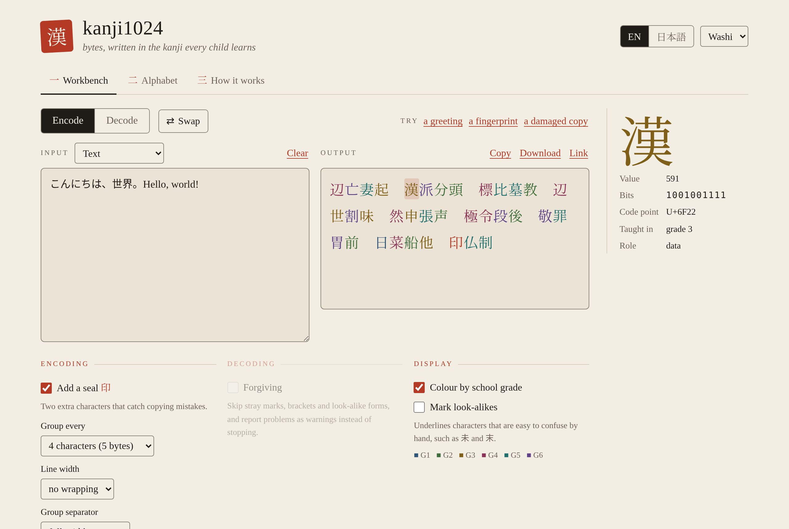
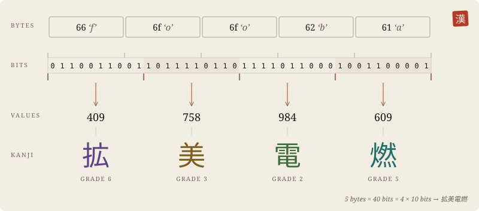
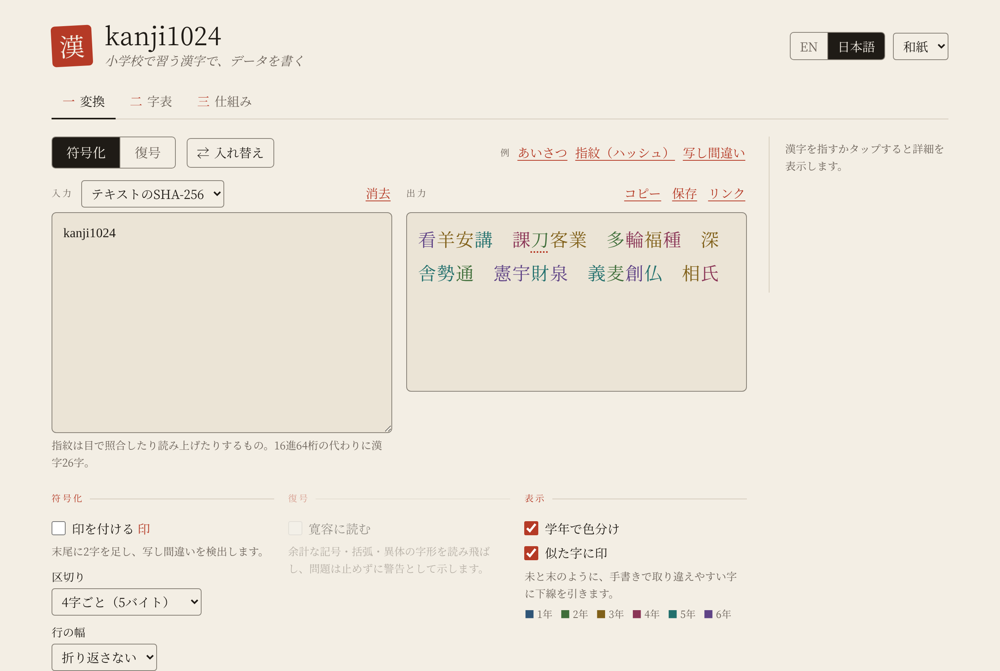
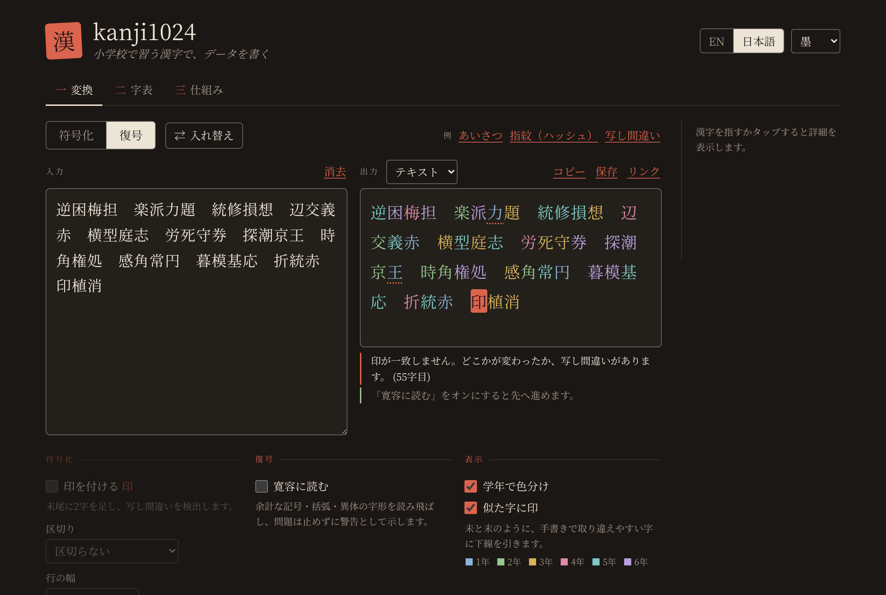
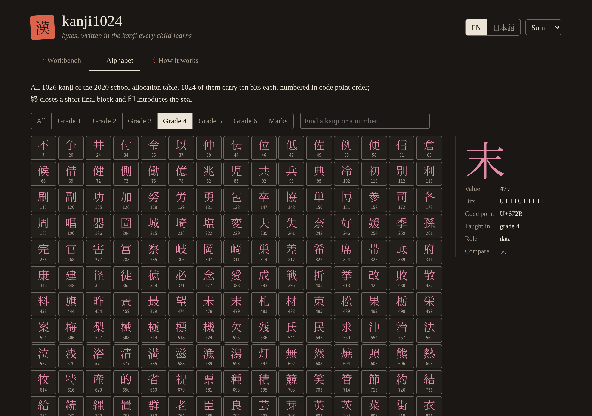
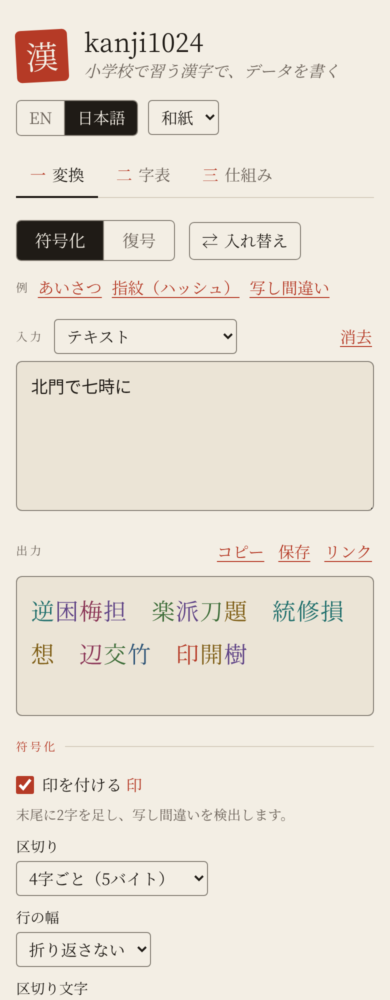

# kanji1024

Write any data as the kanji taught in Japanese primary school, and read it back exactly.

```
Hello, world!   →   専灰色判　名模朝貨　敬済俵
```

Every character in the output is one of the 1026 kanji a child learns by the end of sixth grade. Each one carries ten bits, so 32 bytes, the size of a typical file fingerprint, become 26 kanji instead of 64 hex digits.

**Open the workbench: <https://didvc.github.io/kanji1024/>** It runs entirely in your browser and sends nothing anywhere.



## 日本語の概要

kanji1024は、任意のデータを小学校で習う漢字（教育漢字1026字）だけで書き表し、元に戻す表記法です。1字が10ビットを表すので、32バイトの指紋（ハッシュ値）は漢字26字になります。読み上げや書き写し、日本語の紙面に載せる短いコードに向いています。暗号ではありません。誰でも元に戻せます。画面は日本語と英語を切り替えられます。

## What it is for

It is good for data that people have to handle themselves. You can read a fingerprint aloud over the phone or compare one by eye. You can copy a recovery code onto paper. You can pass a short identifier through a channel that keeps Japanese text intact but mangles punctuation, and you can print a code that looks at home on a Japanese page.

It is not for saving space. In UTF-8 each kanji takes three bytes, so a kanji1024 string is larger on disk than the same data in base64; it is only shorter when you count characters. It is not for secrets either, since anyone can decode it. In web addresses it is a poor fit, because every kanji is escaped to nine ASCII characters.

| 32-byte fingerprint as | characters | UTF-8 bytes |
|---|---|---|
| hex | 64 | 64 |
| base64 | 44 | 44 |
| kanji1024 | 26 | 78 |

## How it works

The data is cut into blocks of five bytes. Five bytes are forty bits, which split into four numbers from 0 to 1023, and each number is written as one kanji. The 1024 kanji used for numbers are taken in code point order, so 0 is 一 and 1023 is 鼻. Of the 1026, two are left over and serve as marks: 終 closes a final block of exactly four bytes (the one length that would otherwise be ambiguous), and 印 starts the optional seal.



## Using the workbench

Choose Encode, then type or paste text. The kanji appear as you type. The input menu also accepts hex, base64, a file, or "SHA-256 of text", which encodes the fingerprint of what you type rather than the text itself.



Tick "Add a seal" for anything a person will copy. The seal is 印 followed by two kanji, and it catches a mistyped or swapped character when the text is read back. "Group every 4 characters" puts a space after each block of five bytes, which makes long strings easier to read in chunks.

Choose Decode and paste kanji1024 text to get the original bytes back, shown as text, hex or base64, or saved as a file. Spaces and line breaks never matter. If the text was damaged, the workbench says what went wrong and points at the spot. In the example below, 刀 was copied as 力 and the seal caught it.



"Forgiving" reading skips brackets, quotation marks and other stray characters, and accepts compatibility forms of the same kanji. It reports what it skipped instead of stopping. A broken seal is always reported.

"Mark look-alikes" underlines kanji that are easy to confuse when written by hand, such as 未 and 末, 土 and 士, or 人 and 入, so you know where to look twice. "Colour by school grade" tints each kanji by the grade that teaches it.

The Alphabet tab lists all 1026 characters with their values. You can filter by grade and search by kanji or number, and clicking a kanji shows its value, bits and look-alikes.



The Link button copies an address that reopens the workbench with the same input and settings. Inputs longer than a few thousand characters and files are left out of the link. The theme follows your system, or you can pick Washi (light) or Sumi (dark). The page also works on a phone.

<p align="center"></p>

## Command line

The same encoder runs in a terminal with a JavaScript runtime (version 18 or later) and no installation:

```sh
echo -n 'Hello, world!' | node bin/kanji1024.mjs            # encode standard input
node bin/kanji1024.mjs --seal --group 4 photo.jpg > photo.txt
node bin/kanji1024.mjs --decode photo.txt > photo-copy.jpg
node bin/kanji1024.mjs --decode --lenient scanned.txt        # read past stray marks
node bin/kanji1024.mjs --info 未末                            # value, grade, look-alikes
```

`node bin/kanji1024.mjs --help` lists every option. The exit status is 1 when input cannot be decoded and 2 for a usage mistake.

## From other pages and scripts

The site has a small API at <https://didvc.github.io/kanji1024/api/>. Like the workbench, it computes in the browser. A browser, or a headless browser that runs scripts, gets a JSON answer in the page body. A plain HTTP client gets a usage guide instead.

```
api/?op=encode&text=Hello%2C%20world!&seal=1&group=4
→ { "ok": true, "op": "encode", "version": "1.0.0", "bytes": 13,
    "output": "専灰色判　名模朝貨　敬済俵　印重独", "characters": 14 }
```

The operations are `encode` (from `text`, `hex` or `base64`), `decode` (from `kanji`), `describe`, `alphabet` and `version`. The guide lists every option. Scripts that drive a headless browser should wait until the page's root element has a `data-status` attribute, then read the text of `#out`.

Web pages can skip the API and import the library itself:

```js
import { encodeText, decodeText } from "https://didvc.github.io/kanji1024/src/kanji1024.mjs";
```

## Copying by hand

Write in groups of four kanji, one block each, and always add the seal. If a decoded seal does not match, check the underlined look-alikes first, since that is where most copying mistakes happen. Writing 終 is only needed when the last group has four kanji and the data length leaves a remainder of four bytes; the encoder adds it for you and the reader checks it.

## Glossary

| Term | 用語 | Meaning |
|---|---|---|
| kyōiku kanji | 教育漢字 | the 1026 kanji assigned to grades 1–6 of primary school |
| allocation table | 学年別漢字配当表 | the official list that assigns each of those kanji to a grade; kanji1024 uses the edition in force from April 2020 |
| grade | 学年 | the school year in which a kanji is taught, 1 to 6 |
| encode | 符号化 | turn bytes into kanji1024 text |
| decode | 復号 | turn kanji1024 text back into bytes |
| block | ブロック | five bytes, written as four kanji |
| data character | データ字 | one of the 1024 kanji that stand for a number from 0 to 1023 |
| value | 値 | the number, 0–1023, that a data character stands for |
| end mark 終 | 終端字 | closes a last block that holds exactly four bytes |
| seal 印 | 印 | an optional checksum: 印 plus two kanji |
| look-alike | 似た字 | kanji easily confused when handwritten, such as 未 and 末 |
| strict reading | 厳格な復号 | the default; any damage stops decoding |
| forgiving reading | 寛容な復号 | skips stray characters and reports problems as warnings |
| fingerprint | 指紋 | a short hash, such as SHA-256, used to recognise a file or key |

## The name and the standard

The full rules are in [SPEC.md](SPEC.md), and the character table is [data/alphabet.tsv](data/alphabet.tsv). The repertoire is frozen at the 2020 edition of the allocation table, so text written today decodes the same way after any future curriculum revision. Software may call itself kanji1024 only if it reproduces the published test vectors exactly. A variant with a different character set or order should take a different name, so that two programs that share the name always agree.

## Citing

See [CITATION.cff](CITATION.cff).

## Licence

The code, meaning the library, command line tool, workbench and tests, is licensed under the Apache License 2.0 ([LICENSE](LICENSE)). The specification, the character table and the images are licensed under Creative Commons Attribution 4.0 ([LICENSE-CC-BY-4.0](LICENSE-CC-BY-4.0)).

## Disclaimer

kanji1024 is a way of writing data down. It does not hide, encrypt or authenticate anything. The seal is designed to catch accidental copying mistakes; someone changing the text on purpose can recompute it, so use a cryptographic signature when tampering matters. The software and specification are provided as is, without warranty of any kind; see the licences for the full terms. You are responsible for checking that decoded data is what you expect before relying on it.

This project is independent. It is not affiliated with, endorsed by, or connected to any ministry, school board or other public body. The character list reproduces the publicly issued grade allocation table, and the grade colours and look-alike notes are informal reading aids with no educational authority.
